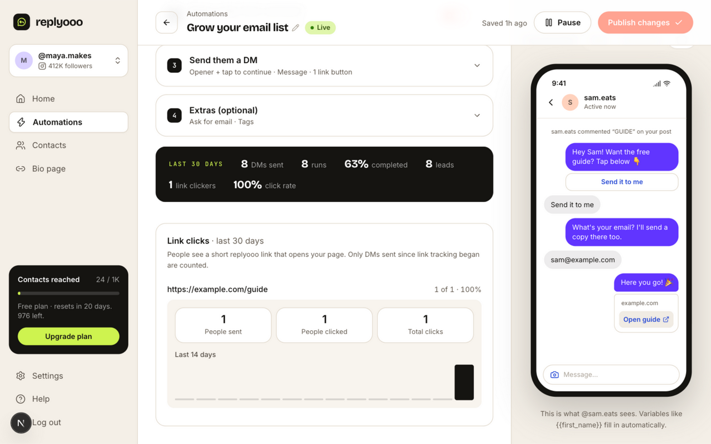
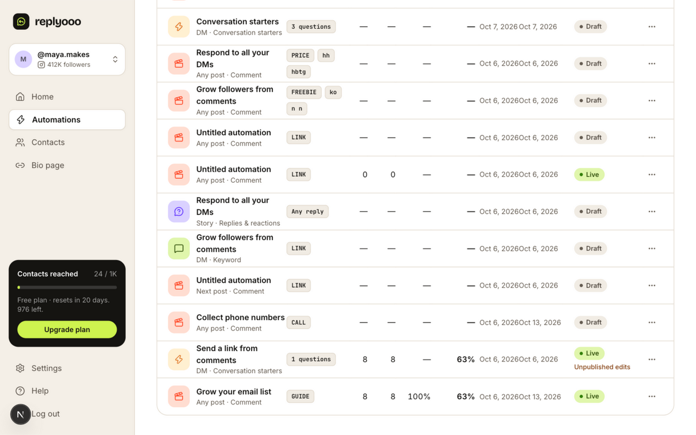

# Claude handoff: link click tracking

Date: 2026-10-13 (Asia/Kolkata). Prepared by Codex after Claude hit its session limit.

## Current status

Feature implementation and local verification are finished on `feat/link-click-tracking`. The full web suite still has one pre-existing marketing inventory failure. Nothing was merged, pushed, or deployed during this continuation. Do not redo Tasks 1–5.

Sources:
- [Implementation plan](../superpowers/plans/2026-10-13-link-click-tracking.md)
- [Design](../superpowers/specs/2026-10-13-link-click-tracking-design.md)
- Local execution ledger: `.superpowers/sdd/2026-10-13-link-click-tracking/progress.md`

Claude's session was `f682e1e7-cd24-4f0c-891f-b5a283ee4491`. It stopped during Task 6, after opening the demo automation and scrolling toward the “Link clicks” section.

## Existing implementation

| Commit | Change |
| --- | --- |
| `688839f` | Database tables, migration, link codes, aggregates and tests |
| `31f99b2` | Worker rewrites DM/private-reply URL buttons to tracked links |
| `9419aa5` | Unique comment IDs for tracking test fixtures |
| `eac9dda` | Public `/l/[code]` redirect, bot/HEAD suppression, robots exclusion |
| `6726b07` | Click rate in automation list and editor statistics |
| `8ffa97f` | Per-destination Link clicks section and 14-day chart |

Only URL buttons in flow-run DMs/private replies are tracked. Message-text URLs are unchanged. Recipient/clicker cohorts use links created during the 30-day window and successfully sent messages; repeat visits increase total clicks while unique clickers remain distinct contacts. Links survive deletion of their automation/message/contact. Tracking failures fall back to original DM URLs.

## Work completed by Codex

1. Ran fresh database, worker and full web suites, uncached workspace typechecks, and the production web build.
2. Finished browser verification using the local dev database on port 3217. The editor showed one link clicker and 100% click rate. Opening `https://example.com/guide` showed one recipient, one clicker, one total click and today's populated bar in the 14-day chart. The automations table showed 100% for the same automation.
3. Rechecked the live local redirect: a human GET returned `302 https://example.com/guide` with `Cache-Control: no-store` and added one click. A bot GET and human HEAD returned 302 without adding clicks. Malformed and unknown codes returned 404. The original demo click count was 1 and the final count was 2 after the additional human visit.
4. Confirmed the local migration had already been applied by Claude and the demo link existed; did not reinsert it or reapply the migration.
5. Added the deployment note in [deploy.md](../deploy.md): worker `APP_URL` must be the public web origin. Both production Compose services use `https://${DOMAIN}`; with Dokploy, DOMAIN must refer to the app host rather than the webhook host. This was a configuration inspection, not a deployed check.
6. Deleted only the `Demo1234` fixture (remaining rows with that code: 0). Its clicks cascade-delete. Stopped Claude's `next dev --port 3217` process and confirmed no listener remained on that port. The local schema migration remains applied.
7. Added the real-phone check to Claude's project memory file `pending-real-world-tests.md` and this handoff.

### Final review and fix

A fresh read-only reviewer inspected `54087ea..8ffa97f`, including all six Review Focus cases. It found one Important issue: raw Unicode destination strings passed into the Location header caused a ByteString error and a 500 instead of a redirect.

Codex added a regression test with `https://例子.com/你好?q=世界`, watched it fail with the ByteString TypeError, then normalized the validated destination using `new URL(link.url).href`. GET and HEAD now redirect to the encoded destination; GET counts once and HEAD does not count. The route test file passed 17/17 after the fix. The fix is committed as `4c73e20` (`fix(web): encode Unicode destinations in tracked link redirects`).

No Critical issues or new Minor issues were reported. The fix was verified through the failing/passing regression and full web-suite run; there was no second reviewer pass.

## Verification results

| Command | Result |
| --- | --- |
| `pnpm --filter @replyooo/db test` | 27/27 tests; 5 files passed |
| `pnpm --filter @replyooo/worker test` | 93/93 tests; 13 files passed |
| `pnpm --filter @replyooo/web exec vitest run test/link-redirect.test.ts` | 17/17 passed after Unicode fix |
| `pnpm --filter @replyooo/web exec vitest run` | 250 passed, 1 failed; 24 files passed, 1 failed |
| `pnpm typecheck --force` | 7/7 tasks passed, none cached; rerun after fix |
| `pnpm --filter @replyooo/web build` | Production build completed after fix; `/l/[code]` included |
| `git diff --check` | Passed |

The failing test is `test/marketing.test.ts > public pages > has every page Meta App Review and the footer link to`. It expects an exact list of six pages, while the marketing tree has eleven. The base revision already has the additional pages, and `git diff 54087ea..8ffa97f` is empty for the marketing routes and this test. It was left unchanged; do not report the full suite as green. Update the inventory assertion in a separate change to check the required pages without rejecting additional valid marketing pages.

Logs live under `.superpowers/sdd/2026-10-13-link-click-tracking/`: `codex-db.log`, `codex-worker.log`, `codex-web-final.log`, `codex-typecheck-final.log`, `codex-build.log`, and `codex-unicode-{red,green}.log`. These files are ignored scratch evidence; this document is the committed record.

### Screenshots inspected

Editor metrics and expanded per-link chart, captured before the second human visit and fixture cleanup:

Automation list with the demo automation's 100% click rate:

## Remaining work

- **Real Meta/phone test:** send a real DM containing a link button from a connected account, tap it on a phone, confirm one click lands, and check whether Instagram's in-app browser or scanner prefetch inflates counts. No actual Instagram message was sent in this continuation. The demo account displayed a revoked-access banner; UI verification used seeded local records.
- **Separate existing test issue:** resolve the marketing page inventory failure before claiming the full suite is green or integrating the branch.
- **Integration:** the branch remains local for Claude/user to decide how to integrate. No PR was created. Do not infer authorization to deploy from this handoff.

## Recorded decisions and deferred items

Earlier ledger rulings remain in effect: two worker fixture comment IDs were made unique to avoid unrelated shared-database collisions; the additional `isBotUserAgent` importer in `u/[slug]/page.tsx` was updated; and the pre-existing marketing test failure was reported rather than folded into link-tracking scope. The only ongoing cost of those decisions is the existing red marketing test.

Claude also recorded a pre-existing worker test, `refuses DMs outside the 24h window`, that reads statuses without ORDER BY and failed intermittently in an earlier run. It passed in Codex's fresh full worker run; no change was made to it.

Task 6's local checks and cleanup are complete. Its all-tests-green expectation and branch-integration step remain pending because of the known marketing failure. Preserve the execution ledger until those are resolved.
